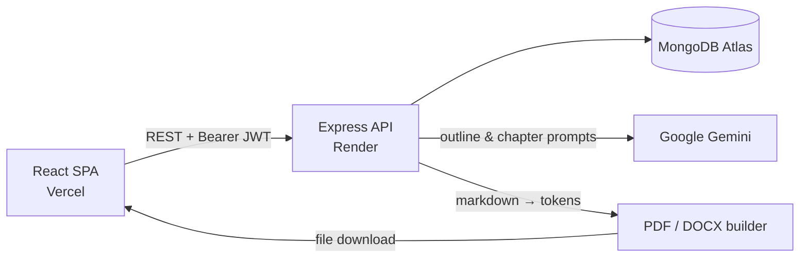

<div align="center">

# AI-Powered eBook Creator

**Plan, write, and export complete eBooks in your browser, with Google Gemini doing the heavy lifting.**


[**Live Demo**](https://your-app.vercel.app) · [Report a Bug](https://github.com/Saicharan519/ai-ebook-creator/issues)

</div>

<!-- Add a short GIF of the full flow here: create book → AI outline → generate chapter → export PDF -->
<!--  -->

## About

Writing a book usually stalls at two points: the blank page and the formatting at the end. This app handles both. You describe a topic, Gemini drafts a chapter outline, you generate or write each chapter in a markdown editor, and then you download a typeset **PDF** or **Word (DOCX)** file with a cover page.

## Features

- **AI outline generation**: give a topic, writing style, and chapter count, and get back a structured outline as JSON.
- **AI chapter writing**: generate a full chapter from its title and description in the chosen style.
- **Markdown editor** with live preview, plus **drag-and-drop chapter reordering** (`@dnd-kit`).
- **PDF and DOCX export**, built server-side from markdown, with a cover image, title page, headings, lists, and inline formatting.
- **Reader mode**: a distraction-free view with adjustable font size.
- **Cover image upload** (`multer`), embedded in both export formats.
- **JWT authentication** with bcrypt-hashed passwords and per-book ownership checks on every endpoint.
- Responsive dashboard for managing all your books.

## Screenshots

| Dashboard | Editor |
|---|---|
|  |  |
| **AI outline** | **Exported PDF** |
|  |  |

## Tech Stack

| Layer | Technologies |
|---|---|
| Frontend | React 19, Vite, React Router 7, Tailwind CSS 4, `@uiw/react-md-editor`, `@dnd-kit`, Axios, react-hot-toast |
| Backend | Node.js, Express 5, Mongoose 9, JWT, bcryptjs, multer |
| AI | Google Gemini (`@google/genai`) |
| Export | `pdfkit` (PDF), `docx` (Word), `markdown-it` (parsing) |
| Database | MongoDB Atlas |
| Hosting | Vercel (frontend), Render (backend) |

## Architecture



The backend follows a **routes → middleware → controllers → services → models** structure:

- `middleware/authMiddleware.js` verifies the JWT and loads the user.
- Controllers check that the requesting user owns the book before reading, updating, deleting, or exporting it.
- `services/bookservice.js` is the data-access layer. It only accepts known fields, so a client can't overwrite the book's owner or cover path.

## Technical Highlights

**Markdown → PDF/DOCX pipeline.** Chapters are stored as markdown. On export, `markdown-it` parses each chapter into a token stream (`heading_open`, `paragraph_open`, `bullet_list_open`, `strong_open`, …). Two hand-written renderers walk those tokens and build the document: `docx` paragraphs and text runs for Word, and `pdfkit` drawing calls for PDF. Font, size, and spacing for each element are kept in one typography config, and a malformed chapter is skipped instead of failing the whole export.

**Reliable structured output from the LLM.** The outline prompt asks Gemini for a JSON array only. The server still pulls out the array between the first `[` and the last `]`, then validates it with `JSON.parse` before saving, so extra text around the JSON doesn't break the flow.

**Security hardening:**
- **Mass assignment:** update requests are filtered to an allow-list of fields.
- **Path traversal:** cover images are resolved by file name inside `uploads/` only, so a stored value like `../.env` can never be read during export.
- **XSS:** chapter content is HTML-escaped before the preview and reader render it.
- **Session expiry:** expired or invalid tokens get a single 401 response, and the frontend clears the session and redirects to login.

## Getting Started

### Prerequisites

- Node.js 18+
- A MongoDB Atlas cluster (the free tier works)
- A Google Gemini API key from [Google AI Studio](https://aistudio.google.com/apikey)

### 1. Clone and install

```bash
git clone https://github.com/Saicharan519/ai-ebook-creator.git
cd ai-ebook-creator
cd backend && npm install
cd ../frontend/ebook && npm install
```

### 2. Configure environment variables

**`backend/.env`** (copy from `backend/.env.example`):

| Variable | Description |
|---|---|
| `MONGO_URI` | MongoDB connection string |
| `JWT_SECRET` | Long random string used to sign tokens |
| `PORT` | API port (default `8000`) |
| `GEMINI_API_KEY` | Google Gemini API key |

**`frontend/ebook/.env.local`** (copy from `frontend/ebook/.env.example`):

| Variable | Description |
|---|---|
| `VITE_API_BASE_URL` | Backend URL. Defaults to `http://localhost:8000` |

### 3. Run

```bash
# Terminal 1: API on http://localhost:8000
cd backend && npm run dev

# Terminal 2: app on http://localhost:5173
cd frontend/ebook && npm run dev
```

Check the API with `GET http://localhost:8000/health`. It reports whether MongoDB is connected.

## API Reference

Every route except register, login, and health requires `Authorization: Bearer <token>`.

| Method | Endpoint | Description |
|---|---|---|
| `POST` | `/api/auth/register` | Create an account |
| `POST` | `/api/auth/login` | Log in and receive a JWT |
| `GET` | `/api/auth/profile` | Get the current user |
| `PUT` | `/api/auth/profile` | Update display name |
| `GET` | `/api/books` | List your books |
| `POST` | `/api/books` | Create a book (with optional chapters) |
| `GET` | `/api/books/:id` | Get one book |
| `PUT` | `/api/books/:id` | Update title, subtitle, author, status, or chapters |
| `DELETE` | `/api/books/:id` | Delete a book |
| `POST` | `/api/books/cover/:id` | Upload a cover (`multipart/form-data`, field `coverImage`) |
| `POST` | `/api/ai/generate-outline` | `{ topic, style, numChapters, description }` → `{ chapters: [{ title, description }] }` |
| `POST` | `/api/ai/generate-chapter-content` | `{ chapterTitle, chapterDescription, style }` → `{ content }` |
| `GET` | `/api/export/:id/pdf` | Download the book as PDF |
| `GET` | `/api/export/:id/docx` | Download the book as DOCX |
| `GET` | `/health` | Server and database status |

## Project Structure

```
backend/
├── config/db.js              # MongoDB connection
├── controllers/              # auth, book, ai, export (markdown → PDF/DOCX)
├── middleware/               # JWT auth, multer upload
├── models/                   # User, Book (embedded chapters)
├── routes/                   # /api/auth, /api/books, /api/ai, /api/export
├── services/bookservice.js   # Book data-access layer
└── server.js

frontend/ebook/src/
├── pages/                    # Landing, Login, Signup, Dashboard, Editor, ViewBook, Profile
├── components/               # editor, view, landing, layout, ui, auth
├── context/Authcontext.jsx   # Auth state
└── utils/                    # API paths, Axios instance, helpers
```

## Deployment

- **Frontend (Vercel):** set the root directory to `frontend/ebook` and add `VITE_API_BASE_URL`. `vercel.json` rewrites every route to `index.html` so client-side routing works.
- **Backend (Render):** set the root directory to `backend`, the build command to `npm install`, the start command to `npm start`, and add the backend environment variables. Use `/health` as the health check path.

## Roadmap

- [ ] Stream AI output to the editor in real time (Server-Sent Events)
- [ ] Rate limiting on AI endpoints
- [ ] Request validation with Zod
- [ ] Store covers in cloud storage (Render's disk is wiped on redeploy)
- [ ] API tests (Jest + Supertest) and GitHub Actions CI
- [ ] Autosave and chapter version history
- [ ] EPUB export and public share links

## Author

**Sai Charan**: [GitHub](https://github.com/Saicharan519)
