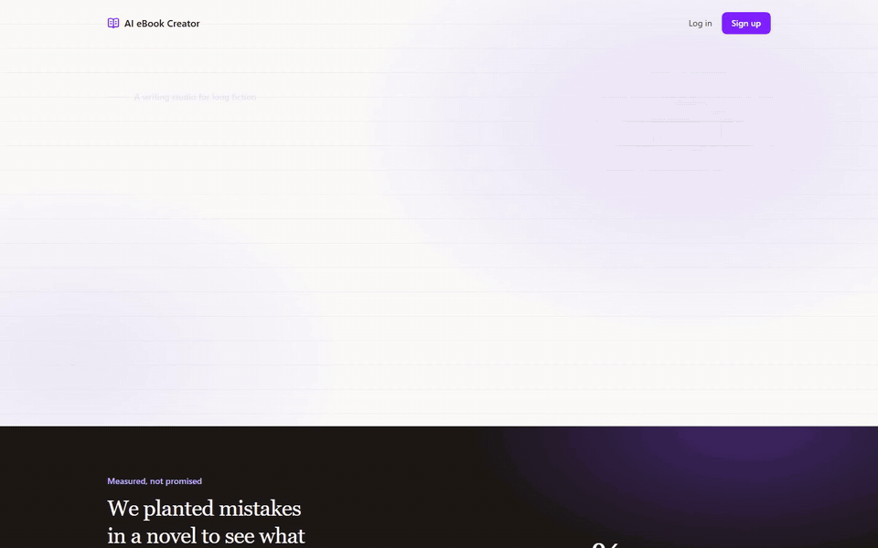
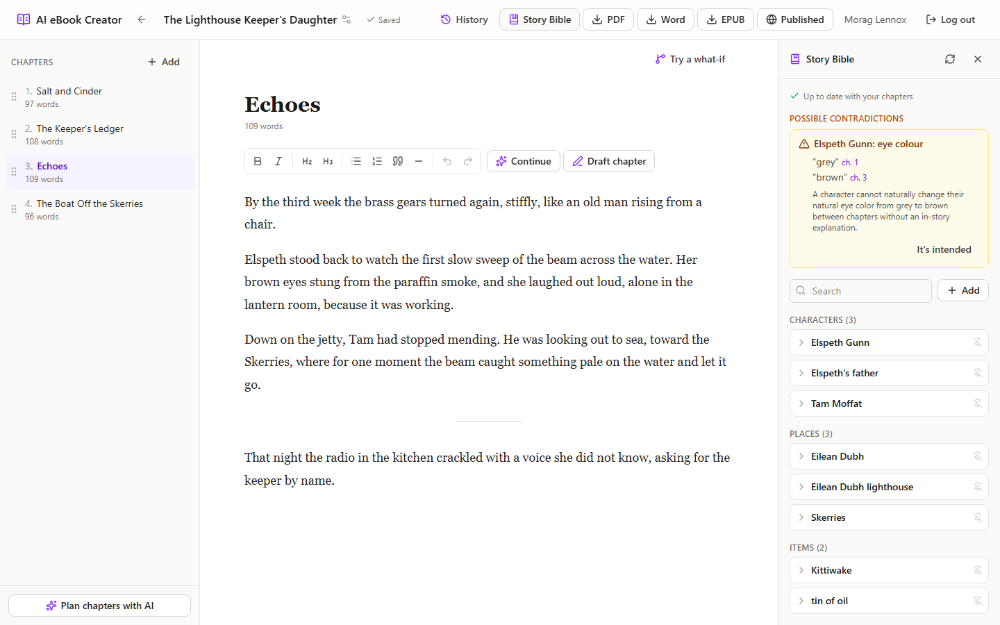
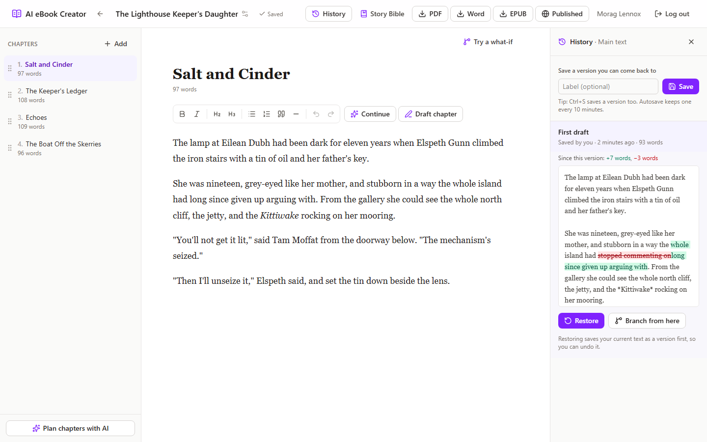
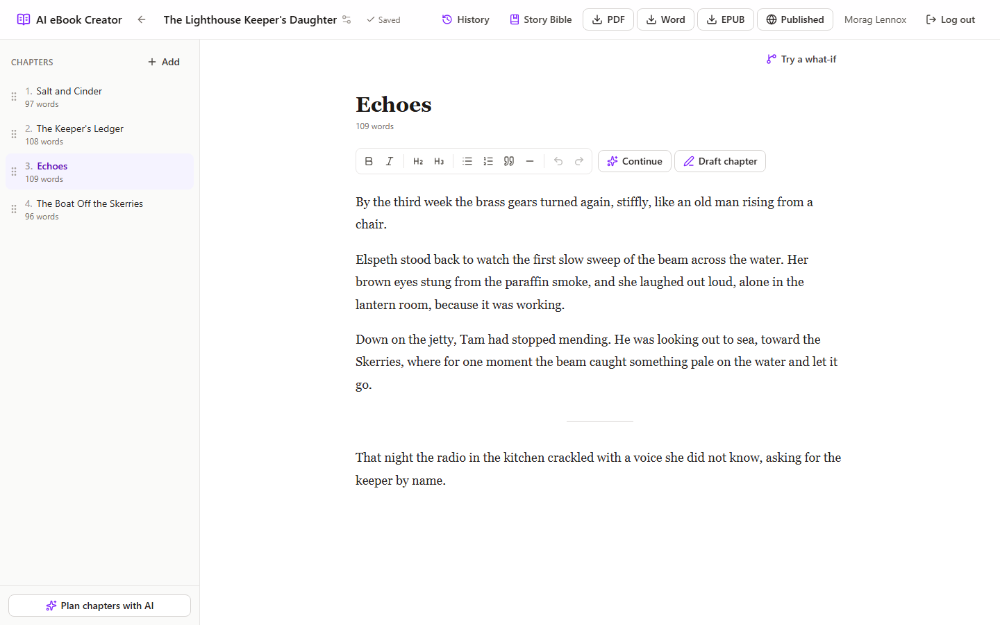
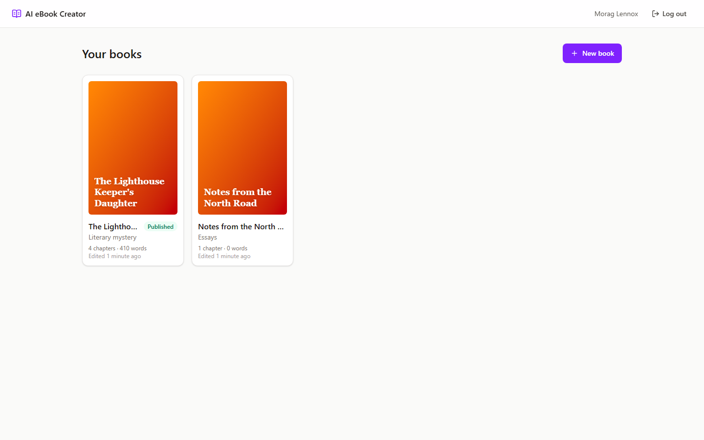
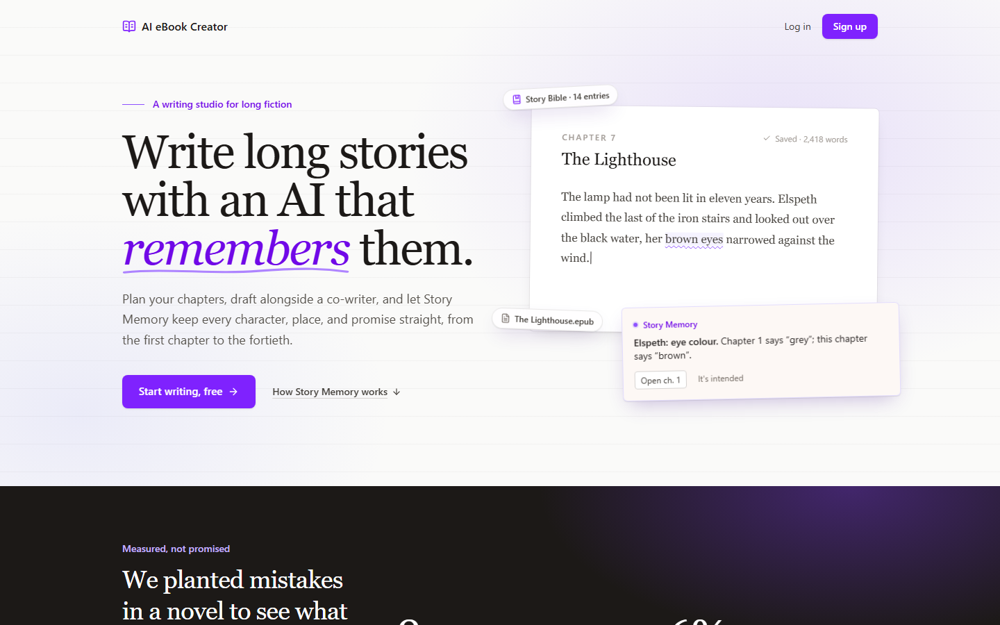
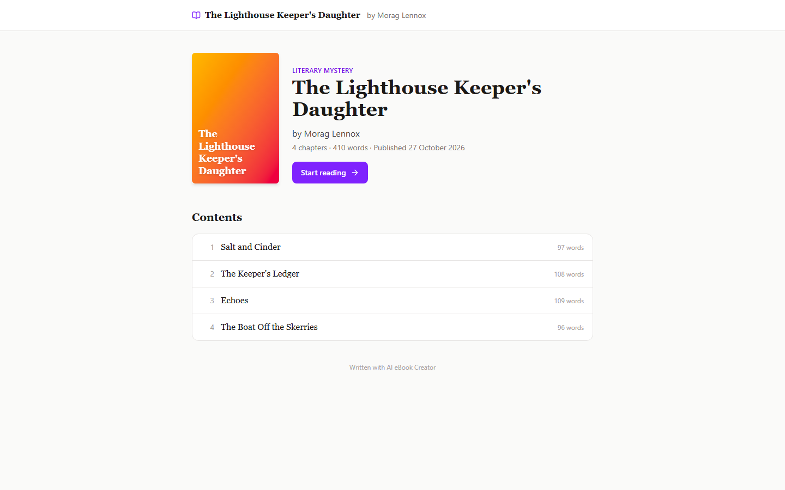
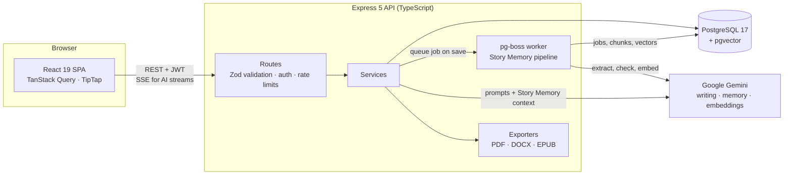
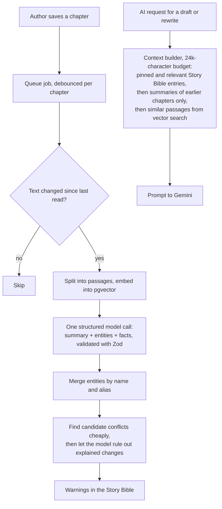

<div align="center">

# AI eBook Creator

**A writing studio for novels and long stories, with an AI co-writer that remembers your characters, places, and plot across every chapter.**

[](https://github.com/Saicharan519/ai-ebook-creator/actions/workflows/ci.yml)


</div>



## Why this exists

AI writing tools are good at the next paragraph and bad at the fortieth chapter. By chapter 15 they have forgotten that the heroine's eyes were grey in chapter 1, that the doctor was a woman, or that the grandmother died. **Story Memory** fixes that: the app reads every chapter in the background, keeps a Story Bible of what the book has established, feeds the relevant parts into every AI request, and flags contradictions with links to both chapters.

On a test novel with 7 planted continuity errors, it caught **76% of them across 3 runs, with zero false alarms** ([evaluation](#story-memory)).

## Features

**Writing**
- Chapter editor (TipTap, saved as Markdown) with debounced autosave and a "Saving… / Saved" indicator
- Drag-and-drop chapter ordering, book details, and cover upload

**AI co-writer** (Google Gemini)
- Plan a book's chapters from its premise
- Draft a chapter, or select text and continue, rewrite, expand, shorten, change tone, or "show, don't tell"
- Suggestions stream in word by word (Server-Sent Events); stop, retry, accept, or discard
- Per-user daily token quota and rate limits

**Story Memory**
- Background reading of every saved chapter: summaries, characters, places, items, and checkable facts
- A Story Bible you can search, edit, and pin
- Contradiction warnings, each linking to both chapters; dismissed ones stay dismissed
- AI requests get a token-budgeted context built from the Story Bible, earlier chapters, and similar passages (vector search)

**History and what-ifs**
- Version history: saved on request (Ctrl+S), before every AI change, before a restore, and every 10 minutes while autosaving
- Word-by-word diff against any version, and one-click restore (which can itself be undone)
- What-if branches: rewrite a chapter in a separate draft, then keep it or throw it away

**Finishing**
- Export to **PDF** (contents page with page numbers and links), **Word**, and **EPUB 3**, each with cover and table of contents
- Publish to a public reading page at a shareable link; no account needed to read

## Screenshots

| Story Bible flags a contradiction | Version history with a word diff |
|---|---|
|  |  |
| **Editor** | **Your books** |
|  |  |
| **Landing page** | **Public reader** |
|  |  |

## Architecture



The repository is an npm-workspaces monorepo:

| Package | What it is |
|---|---|
| [`apps/api`](apps/api) | Express 5 + TypeScript REST API. One folder per feature under `src/modules` (auth, books, chapters, versions, ai, memory, export, public). Prisma for data access. |
| [`apps/web`](apps/web) | React 19 + Vite + Tailwind 4 single-page app. Feature folders under `src/features`. |
| [`packages/shared`](packages/shared) | Zod schemas and types used by **both** apps, so the API's validation and the web app's types can never disagree. |
| [`e2e`](e2e) | Playwright test that drives the whole app in a real browser. |

### Story Memory



- **Background reading** runs on [pg-boss](https://github.com/timgit/pg-boss), a job queue stored in Postgres, so there's no Redis to host. Jobs survive restarts and retry with backoff, and a burst of autosaves becomes a single job.
- **Merging** handles the same character under different names: "Elspeth" joins "Elspeth Gunn", but a bare first name only merges when exactly one character fits, and pronouns never become aliases.
- **Consistency checking** is two-stage to keep it cheap: plain matching finds facts about the same entity with related labels and different values; only those pairs go to the model, which rules out rewordings and changes the story explains (a time skip, a death, a haircut).
- **Context building** never includes later chapters (no spoilers in drafts) and degrades gracefully: if vector search or the Story Bible is unavailable, the request continues without that part.
- **Background work uses a cheaper model** (`GEMINI_MEMORY_MODEL`) with its own quota, so memory updates never use up the quota for writing help.

**Evaluation** ([full report](docs/eval/story-memory.md), [source](apps/api/eval)): an 8-chapter story with 7 planted contradictions and 4 changes the story explains, read by the real pipeline three times.

| Planted contradiction | Caught |
|---|---|
| Eye colour: green (ch. 1) vs brown (ch. 5) | 3/3 |
| A character dies (ch. 3) but is cooking and talking (ch. 6) | 3/3 |
| The doctor: a woman (ch. 2) vs a man (ch. 6) | 3/3 |
| The injured hand: left (ch. 4) vs right (ch. 5) | 3/3 |
| A village: west coast (ch. 1) vs east coast (ch. 8) | 3/3 |
| A boy's age in the same summer: twelve vs fifteen | 1/3 |
| The family boat renamed between chapters | 0/3 |
| **Total** | **16/21 (76%), 0 false alarms** |

Known limits: a renamed object is merged into one entry rather than flagged, and an age change is only sometimes flagged because the model can't always tell whether time has passed.

## Engineering decisions

**Authentication.** Short-lived (15-minute) access tokens are kept in memory, never in `localStorage`. Refresh tokens live in an httpOnly cookie, are stored hashed, and rotate on every use; reusing an old one revokes the whole session family, which catches a stolen token. A required custom header on the cookie-based routes (`/auth/refresh`, `/auth/logout`) blocks cross-site request forgery.

**One schema, two apps.** Every request body is validated by a Zod schema from `packages/shared`, and the web app uses the same schemas to type and validate responses.

**Ownership is enforced in every query.** Book data is always loaded with `where: { id, ownerId }`, so another user's book returns the same 404 as a missing one. Every route has a test proving it.

**Streaming AI.** Suggestions stream over Server-Sent Events. Closing the tab or pressing Stop aborts the model call, so unread text isn't paid for, and token usage is recorded before the response closes, so the daily quota is always current.

**Version snapshots without bloat.** Autosave snapshots store the text from *before* each save at most every 10 minutes and are pruned to the newest 50 per chapter; versions the author saves are kept. Identical text is never saved twice.

**Exports from one parsed model.** Markdown is parsed once into typed blocks; separate renderers draw PDF (pdfkit, with a contents page whose page numbers are filled in after layout), Word (docx, with bookmark links), and EPUB 3 (assembled by hand: package document, navigation, and one XHTML page per chapter, all text escaped).

**Safe rendering.** Chapter text is shown in the public reader through the editor's own document schema rather than injected HTML, so raw HTML in a chapter can never run.

**Security checklist:** helmet headers, CORS allow-list, rate limits (app-wide, login, AI, and public reader), uploads checked by their actual bytes, storage paths that can't escape the upload folder, one-line request logs with no headers or query strings, and a secret-free git history.

## Tech stack

| Layer | Technologies |
|---|---|
| Web | React 19, Vite, TypeScript, Tailwind CSS 4, React Router, TanStack Query, TipTap, dnd-kit |
| API | Node.js 24, Express 5, TypeScript, Zod, Prisma 7, pg-boss, pino, jose (JWT), bcrypt |
| Data | PostgreSQL 17 with pgvector |
| AI | Google Gemini (`@google/genai`): generation, structured output, embeddings |
| Export | pdfkit, docx, jszip (EPUB), markdown-it |
| Testing | Vitest, Supertest, Testing Library, Playwright |
| Tooling | npm workspaces, ESLint, Prettier, GitHub Actions, Docker Compose |

## Testing

| Suite | What it covers | Count |
|---|---|---|
| API (Vitest + Supertest) | Every route against a real Postgres test database: success, validation, and another user's access; Story Memory with a scripted model; a real pg-boss job end to end | 166 |
| Web (Vitest + Testing Library) | Components and hooks: autosave ordering, AI streaming, Story Bible, history, reader, auth redirects | 45 |
| Shared | Schema rules | 3 |
| End-to-end (Playwright) | Sign up → create a book → AI outline → write with an AI suggestion → history → export PDF and EPUB → publish → read logged out | 1 flow |

Tests never call the real AI: the API takes a `FakeLlmProvider`. CI runs formatting, lint, typecheck, all tests, the build, and the end-to-end test on every push.

## Getting started

**Prerequisites:** Node.js 24 (see `.nvmrc`) and Docker Desktop.

```bash
git clone https://github.com/Saicharan519/ai-ebook-creator.git
cd ai-ebook-creator
git switch v2

docker compose up -d                       # Postgres 17 + pgvector on localhost:5433
cp apps/api/.env.example apps/api/.env     # then set JWT_ACCESS_SECRET (the file shows how)
npm install                                # all workspaces; also generates the Prisma client
npm run db:migrate                         # create the tables
npm run dev                                # API on :8000, web app on :5173
```

Open http://localhost:5173. With `AI_PROVIDER=fake` in `apps/api/.env`, every AI feature works with placeholder text and no API key. For real writing and Story Memory, set `AI_PROVIDER=gemini` and add a `GEMINI_API_KEY` from [Google AI Studio](https://aistudio.google.com/apikey).

| Command | What it does |
|---|---|
| `npm test` | API, web, and shared tests (the API uses a separate `ebook_test` database) |
| `npm run test:e2e` | The Playwright flow (first time: `npx playwright install chromium`) |
| `npm run lint` · `npm run typecheck` · `npm run format` | Code checks |
| `npm run build` | Production builds of the API and the web app |
| `npm run eval:memory -w @ebook/api` | Re-run the Story Memory evaluation (uses real Gemini tokens) |
| `npm run screenshots -w @ebook/e2e` | Re-capture these screenshots and the demo GIF from a running app |

## API overview

All `/books` routes need `Authorization: Bearer <token>` and only ever see the caller's own books.

| Area | Endpoints |
|---|---|
| Auth | `POST /auth/register` · `/login` · `/refresh` · `/logout` · `/logout-all`, `GET /auth/me` |
| Books | `GET/POST /books`, `GET/PATCH/DELETE /books/:id`, `PUT/DELETE /books/:id/cover`, `POST/DELETE /books/:id/publish` |
| Chapters | `POST /books/:id/chapters`, `POST …/chapters/batch`, `PATCH …/chapters/order`, `GET/PATCH/DELETE …/chapters/:chapterId` |
| History | `GET/POST …/chapters/:chapterId/versions`, `GET …/versions/:versionId`, `POST …/versions/:versionId/restore` |
| What-ifs | `GET/POST …/branches`, `GET/PATCH/DELETE …/branches/:branchId`, `POST …/branches/:branchId/keep` |
| AI | `POST /books/:id/ai/outline`; streamed over SSE: `POST …/chapters/:chapterId/ai/draft`, `POST …/ai/inline`; `GET /ai/usage` |
| Story Bible | `GET /books/:id/story-bible`, `POST …/memory/refresh`, entities and facts CRUD, `POST …/warnings/:warningId/dismiss` |
| Export | `GET /books/:id/export/pdf` · `docx` · `epub` |
| Public | `GET /public/books/:slug`, `GET /public/books/:slug/chapters/:chapterId` (no login) |
| Health | `GET /health` (API and database status) |

## Project structure

```
apps/api/
  src/modules/       auth, books, chapters, versions, ai, memory, export, public, health
  src/lib/           env (Zod-validated), Prisma client, LLM providers, logging, storage
  prisma/            schema and migrations
  eval/              Story Memory evaluation (fixture story + runner)
  test/              API tests
apps/web/src/
  features/          auth, books, editor, ai, story-bible, versions, reader
  pages/             route-level pages
packages/shared/     Zod schemas and types
e2e/                 Playwright tests and the screenshot script
docs/                PRD, build plan, evaluation report, screenshots
```

## Deployment

| Part | Host | How |
|---|---|---|
| Database | [Neon](https://neon.tech) (Postgres + pgvector) | Tables are created by `prisma migrate deploy` when the API starts |
| API | [Render](https://render.com) | [`render.yaml`](render.yaml) Blueprint: builds the API, runs migrations, health-checks `/health` |
| Web | [Vercel](https://vercel.com) | Root directory `apps/web`; [`vercel.json`](apps/web/vercel.json) serves the SPA and proxies `/api/*` to Render |

The web app talks to the API through its own `/api` path, so the refresh cookie is first-party (browsers increasingly block third-party cookies) and no CORS preflight is needed. Covers are stored in Postgres (`STORAGE_DRIVER=database`) because Render's free tier has no persistent disk.

## Status and roadmap

v2 is a full rewrite of the original MERN version (still in the `main` branch). The build plan and progress are in [docs/PLAN.md](docs/PLAN.md).

- [x] Foundation, core app, AI co-writer, Story Memory, versions, branches, EPUB, public reader
- [x] End-to-end test in CI
- [ ] Deploy: Neon (Postgres + pgvector), Render (API), Vercel (web), Cloudinary (covers)
- [ ] Merge `v2` into `main`
- [ ] Stretch: real-time co-writing (Yjs)

## Author

**Sai Charan** · [GitHub](https://github.com/Saicharan519)
